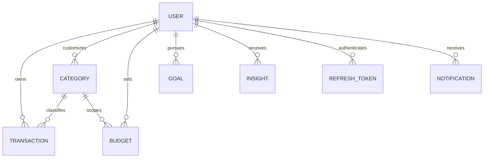

# Finly Database Schema Documentation

Finly uses MongoDB with Mongoose for normalized document persistence. All monetary calculations are backed by integer minor units (`amountInPaise`) to guarantee arithmetic precision.

## 1. Entity-Relationship Overview

## 2. Model Specifications

### 2.1 User (`User.ts`)
| Field | Type | Description |
|---|---|---|
| `_id` | ObjectId | Primary Key |
| `name` | String | User's full name |
| `email` | String | Normalized lowercase email (Unique Index) |
| `passwordHash` | String | Bcrypt hash (excluded by default) |
| `googleSubject` | String | Google OAuth Subject (Sparse Index) |
| `emailVerified` | Boolean | Email verification status |
| `currency` | String | Default `INR` |
| `themePreference`| Enum | `'system'`, `'light'`, `'dark'` |
| `monthlyIncomeTarget` | Number | User income goal |
| `monthlySpendingTarget` | Number | User spending budget |
| `preferences` | Object | `weeklySummary`, `budgetAlerts`, `biometricEnabled` |
| `onboardingCompleted` | Boolean | Whether user finished setup |
| `createdAt` / `updatedAt` | Date | Timestamps |

### 2.2 Transaction (`Transaction.ts`)
| Field | Type | Description |
|---|---|---|
| `_id` | ObjectId | Primary Key |
| `userId` | ObjectId | Foreign Key -> `User` (Indexed) |
| `type` | Enum | `'income'`, `'expense'`, `'transfer'` |
| `amount` | Number | Amount in Rupees (e.g. 250.50) |
| `amountInPaise` | Number | Integer minor units (e.g. 25050 paise) |
| `currency` | String | Default `INR` |
| `categoryId` | ObjectId | Foreign Key -> `Category` (Indexed) |
| `merchant` | String | Merchant / Payee name |
| `description` | String | Brief memo |
| `transactionDate` | Date | Transaction timestamp (Indexed) |
| `paymentMethod` | Enum | `'UPI'`, `'Cash'`, `'Debit Card'`, `'Credit Card'`, `'Bank Transfer'`, `'Other'` |
| `paymentStatus` | Enum | `'success'`, `'pending'`, `'failed'`, `'reversed'` |
| `source` | Enum | `'manual'`, `'upi_screenshot'`, `'receipt'`, `'quick_text'` |
| `referenceId` | String | UPI UTR or Bank Reference ID (Sparse Index) |
| `extractionConfidence`| Number | AI OCR confidence score (0.0 to 1.0) |
| `userConfirmed` | Boolean | Must be true before affecting balances |

**Compound Indexes:**
- `{ userId: 1, transactionDate: -1 }`
- `{ userId: 1, type: 1, transactionDate: -1 }`
- `{ userId: 1, categoryId: 1, transactionDate: -1 }`
- `{ userId: 1, referenceId: 1 }` (Sparse)

### 2.3 Category (`Category.ts`)
| Field | Type | Description |
|---|---|---|
| `_id` | ObjectId | Primary Key |
| `userId` | ObjectId | Null for system defaults; ObjectId for custom |
| `name` | String | Category label |
| `type` | Enum | `'expense'` or `'income'` |
| `icon` | String | Lucide icon name |
| `color` | String | Hex color string |
| `isDefault` | Boolean | Default category marker |
| `isActive` | Boolean | Soft delete status |

**Compound Index:** `{ userId: 1, name: 1, type: 1 }` (Unique)

### 2.4 Budget (`Budget.ts`)
| Field | Type | Description |
|---|---|---|
| `userId` | ObjectId | Foreign Key -> `User` |
| `name` | String | Budget name |
| `categoryId` | ObjectId | Null for overall budget; ObjectId for category-specific |
| `limitAmount` | Number | Limit in Rupees |
| `limitAmountInPaise` | Number | Limit in integer paise |
| `period` | Enum | `'monthly'`, `'weekly'`, `'custom'` |
| `startDate` / `endDate` | Date | Effective period |
| `alertThresholds` | [Number] | Default `[50, 75, 90, 100]` |
| `alertedThresholds` | [Number] | Triggered thresholds in current period |

### 2.5 Goal (`Goal.ts`)
| Field | Type | Description |
|---|---|---|
| `userId` | ObjectId | Foreign Key -> `User` |
| `title` | String | e.g. "Emergency Fund" |
| `targetAmount` | Number | Target in Rupees |
| `targetAmountInPaise` | Number | Target in paise |
| `currentAmount` | Number | Accumulated savings in Rupees |
| `targetDate` | Date | Target completion date |
| `status` | Enum | `'in_progress'`, `'achieved'`, `'paused'` |
| `contributions` | Array | `[{ amount, amountInPaise, date, notes }]` |

### 2.6 Insight (`Insight.ts`)
| Field | Type | Description |
|---|---|---|
| `userId` | ObjectId | Foreign Key -> `User` |
| `type` | Enum | `'spending_increase'`, `'budget_warning'`, `'subscription_review'`, `'saving_opportunity'`, `'positive_habit'` |
| `title` | String | Insight headline |
| `explanation` | String | Clear 2-sentence explanation |
| `metrics` | Mixed | Grounded data dictionary |
| `estimatedSaving` | Number | Potential monthly saving in ₹ |
| `generatedAt` | Date | Generation timestamp |
| `dismissedAt` | Date | User dismissal timestamp |
| `feedback` | Enum | `'helpful'` or `'not_helpful'` |

### 2.7 RefreshToken (`RefreshToken.ts`)
| Field | Type | Description |
|---|---|---|
| `userId` | ObjectId | Foreign Key -> `User` |
| `tokenHash` | String | SHA-256 hash of refresh token |
| `expiresAt` | Date | Token expiry (TTL Index auto-deletes) |
| `revoked` | Boolean | Revocation state |
| `replacedByTokenHash`| String | Rotation audit link |

### 2.8 Notification (`Notification.ts`)
| Field | Type | Description |
|---|---|---|
| `userId` | ObjectId | Foreign Key -> `User` |
| `type` | Enum | `'budget_alert'`, `'high_spending'`, `'weekly_summary'`, `'system'` |
| `title` | String | Alert title |
| `message` | String | Alert body text |
| `readAt` | Date | Read timestamp |

